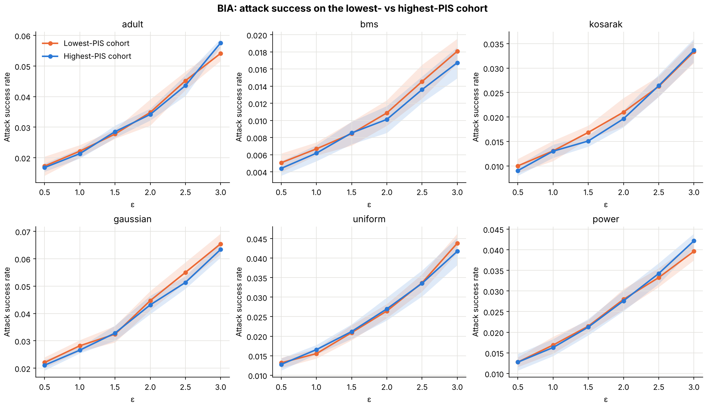
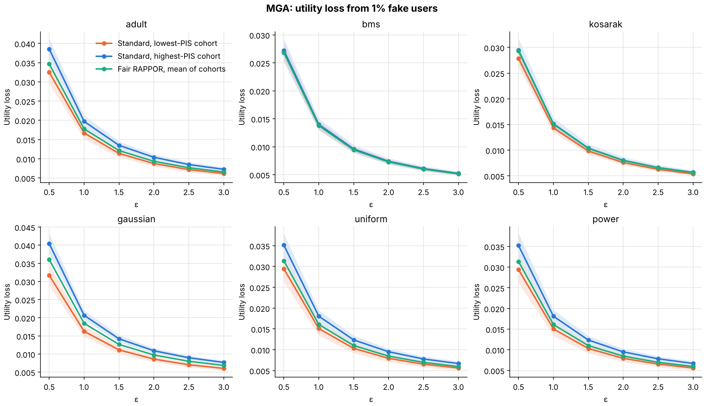
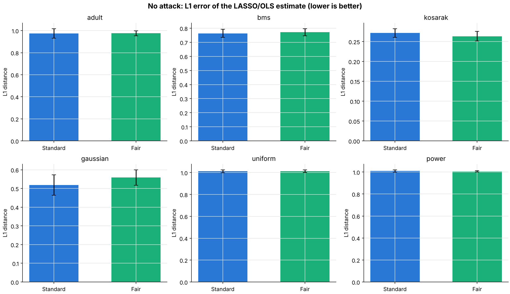
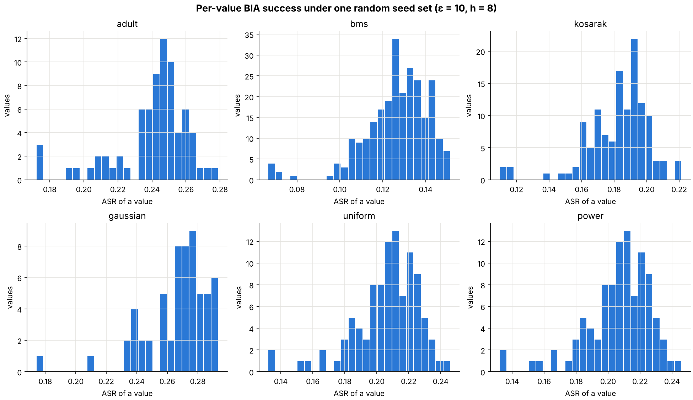

# Fair RAPPOR: Does Cohort Seed Selection Create a Privacy Fairness Gap?

**Result: no.** This project spent about a year testing whether the way
[RAPPOR](https://research.google/pubs/rappor-randomized-aggregatable-privacy-preserving-ordinal-response/)
assigns hash seeds to cohorts creates a *fairness* problem, i.e. whether
some users are structurally easier to de-anonymise than others purely
because of the cohort they were randomly assigned to. Across six datasets
and a range of privacy budgets, the attack success on the "luckiest" and
"unluckiest" cohorts is indistinguishable. This repository holds the
code, the experiments and their results, negative result included.

## Why publish a negative result

If you are evaluating RAPPOR (or any Bloom filter + randomized response
scheme) and wondering whether cohort seed selection needs a fairness-aware
redesign, this repository shows what was tried, how, and why it did not
turn up a meaningful gap.

## The core idea

RAPPOR encodes a value into a Bloom filter (each cohort hashes with its own
`h` seeds) and flips every bit with randomized response calibrated to
`epsilon`. Because seeds are drawn at random, some cohorts happen to spread
the domain over the bits more evenly than others. **Does that random
variation make users in some cohorts easier to attack?**

Two seed metrics:

- **PIS (Preimage Interference Score):** for each value, the number of
  other values sharing at least one bit with it, averaged over the domain.
  Low PIS means more exclusive bits, i.e. more identifying reports.
- **Seed entropy:** how evenly a seed set spreads the domain over the bits.

Two seed-selection strategies:

| Strategy | Function | What it does |
|---|---|---|
| Standard RAPPOR | `standard_seeds()` | Independent random seeds per cohort. |
| Fair RAPPOR (candidate) | `fair_seeds()` | Draws 1000 random seed sets, keeps those between the 10th and 90th PIS percentile, spreads the cohorts evenly over that band. |

## Results

All experiments ran on six datasets: Adult (74 values, 45,222 users),
BMS (256, 500,000), Kosarak (128, 929,669) and three synthetic ones,
Gaussian (60, 100,000), Uniform (100, 100,000) and Power-law (100, 100,000).
Raw numbers are in [`results/`](results), console output in
[`results/logs/`](results/logs).

| Dataset | BIA ASR gap, low − high PIS (all ε) | MGA ULoss at ε = 1: low / high PIS / Fair | No attack L1: standard / fair |
|---|---|---|---|
| adult | −0.0001 ± 0.0039 | 0.0167 / 0.0197 / 0.0178 (+18%) | 0.975 / 0.976 |
| bms | +0.0007 ± 0.0019 | 0.0138 / 0.0140 / 0.0138 (+1%) | 0.764 / 0.772 |
| kosarak | +0.0006 ± 0.0029 | 0.0143 / 0.0152 / 0.0151 (+6%) | 0.272 / 0.263 |
| gaussian | +0.0016 ± 0.0045 | 0.0163 / 0.0207 / 0.0185 (+27%) | 0.519 / 0.559 |
| uniform | +0.0001 ± 0.0032 | 0.0151 / 0.0181 / 0.0161 (+20%) | 1.012 / 1.013 |
| power | −0.0004 ± 0.0032 | 0.0150 / 0.0181 / 0.0161 (+20%) | 1.009 / 1.006 |

**1. No privacy fairness gap (BIA).** Out of 64 standard cohorts, the
lowest- and highest-PIS ones are attacked with a maximum-likelihood
attacker, 5,000 users × 10 runs per point. On every dataset and every ε the
two curves overlap within one standard deviation, and the gap has no
consistent sign. The PIS difference between cohorts is real (about 2 values
of overlap) but does not reach attack success.



**2. A robustness asymmetry, not a privacy one (MGA).** When 1% fake users
inject crafted reports, the damage to the frequency estimates is larger if
they land in the highest-PIS cohort: +18–27% on the small-domain datasets
(the highest-PIS cohort was worse in 9–10 of 10 runs), +1–6% on BMS and
Kosarak. A target's bits are shared by more values there, so the poison
spreads further. This concerns the aggregate estimate, not how exposed an
individual user is. Fair RAPPOR sits between the two extremes, as designed.



**3. Fairness costs nothing, and buys nothing, without an attacker.**
Standard and Fair seeds give the same L1 error within noise. (With
`ε = ln 3, k = 64, h = 2, m = 4`, decoding detects only a handful of values
on Adult, Uniform and Power, so L1 ≈ 1 there; the comparison is meaningful
on BMS, Kosarak and Gaussian.) With only 4 cohorts, Fair RAPPOR's cohorts
are spread across the 10–90 band, so their PIS range is not smaller than
with random seeds.



**4. Per-value differences exist but come from individual collisions.**
Under one fixed seed set (`ε = 10, h = 8`), per-value BIA success varies
about twice as much as sampling noise alone would explain; the few
hardest values are those that collide with others under that particular
seed set. Since each cohort uses different seeds, this does not single out
the same users across cohorts.



**5. Entropy is not a better signal.** Seed sets at the 10th, 50th and 90th
entropy percentile give the same ASR and utility within noise
(`analysis/entropy_vs_attack_success.py`).

## Repository layout

```
src/
  rappor_client.py              Encoding, perturbation, simulated per-cohort counts
  rappor_onetime_aggregator.py  LASSO + OLS decoding with Bonferroni-corrected significance
  seed_selection.py             PIS, seed entropy, standard and Fair seed selection
  datasets.py                   Dataset loading and result saving

experiments/
  experiment_bia.py             Bayesian Inference Attack on lowest- vs highest-PIS cohort
  experiment_mga.py             Manipulation-Guided Attack: utility loss from fake reports
  experiment_no_attack.py       Estimation accuracy, standard vs Fair seeds
  vulnerability_test.py         Per-value attack success under one seed set
  plot_results.py               Figures in results/

analysis/
  pis_definitions.py            Rejected exact-match PIS (v1) vs the any-shared-bit PIS used
  collision_depth_distribution.py  Same seed vs independent seeds
  entropy_vs_attack_success.py  Entropy as an alternative metric
```

## Running

```bash
pip install -r requirements.txt
cd experiments
python experiment_bia.py            # all six datasets
python experiment_mga.py adult bms  # or only some
python experiment_no_attack.py
python vulnerability_test.py
python plot_results.py
```

Each script writes `results/<experiment>_<dataset>.csv`. The full set runs
in about 15 minutes on a laptop. See [`datasets/README.md`](datasets/README.md)
for the data.

### Implementation notes

- Values are hashed once per seed set into a Bloom matrix; perturbation and
  the attack are vectorised over users.
- For the aggregate experiments (MGA, no attack) per-cohort bit counts are
  drawn directly as `Binomial(n1, q) + Binomial(N_j − n1, p)`, which has the
  same distribution as summing every individual report.
- With `q = 1 − p`, the maximum-likelihood BIA guess is the value whose
  Bloom filter is closest in Hamming distance to the report (ties broken at
  random).

## Limitations

This is a research codebase, not a production RAPPOR implementation: no
permanent randomized response, no client-side rate limiting. It is meant
for studying the fairness question above.

## Acknowledgements

This project was carried out at Koç University under the supervision of
Emre Gürsoy. Thanks to Berkay Kemal Balioglu and Alireza Khodaie for
tutoring during the project. Code cleanup and experiment refactoring were
assisted by AI tools.

## License

MIT, see [`LICENSE`](LICENSE).
